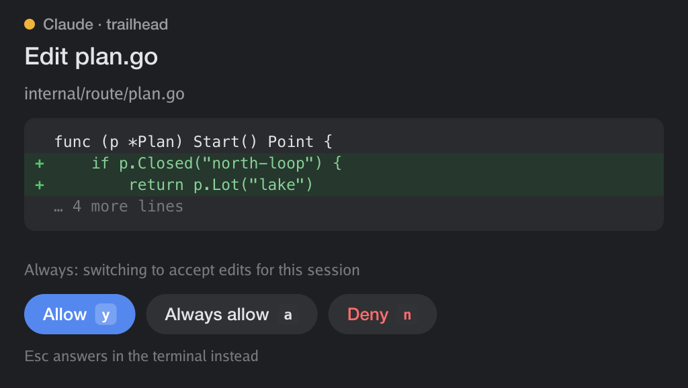
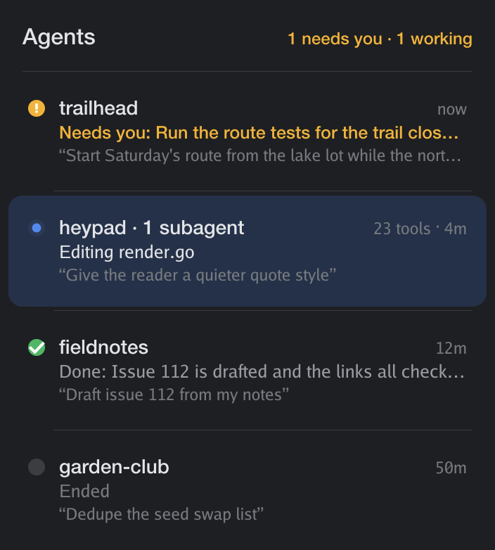
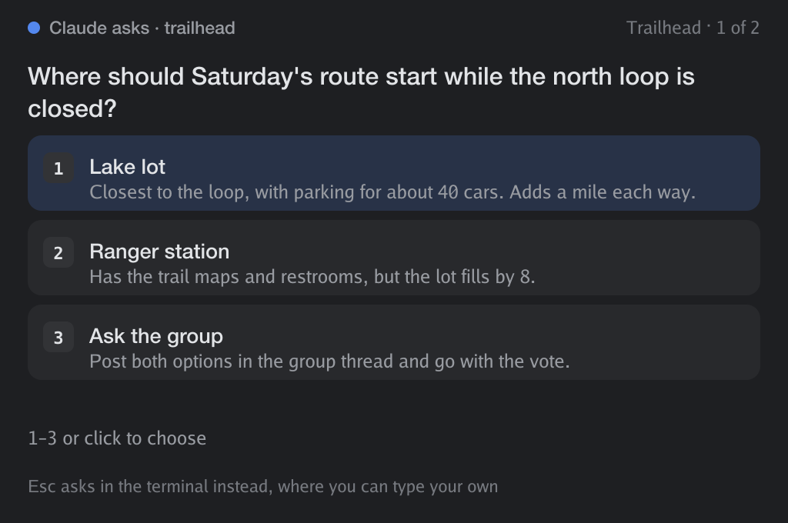

# agentpad

**Claude Code, at home in [Rex](https://superlogical.com).**

agentpad doesn't reinvent the wheel. It just makes the wheel more stylish.

Claude Code's terminal UI stays exactly as it is. agentpad adds what Rex can
give it: permission prompts that come to you as drawn approval sheets,
floating over whatever you're looking at, and a board that shows what every
agent is doing right now. Everything is drawn with the kitty graphics
protocol, at your display's pixel density, in your Rex theme's colors.

<p align="center">
  
  
</p>

<sub>The pictures show made-up sessions (`agentpad render`).</sub>

## Approvals that come to you

When Claude asks to run a command or change a file, a sheet floats over the
Rex window you're looking at, even if the agent is in another tab, or you're
on the iPad. It shows what Claude wants to do the way you'd want to read it:
the command in a code box, an edit as a diff, a new file's contents.

- **y** allows it, **a** always allows it (and says what that remembers,
  such as "commands starting with go test in this project"), **n** denies it.
  Clicking the buttons works too.
- **You can't allow what you haven't been shown.** A command or diff longer
  than the sheet scrolls (**Space**, the arrow keys), and Allow waits until
  you've reached the end. Deny works at any point. The same goes everywhere
  else a request can be answered: a card that can't show all of it sends
  you to where you can read it.
- **Esc** leaves it to the terminal. Claude Code's own prompt is up the whole
  time, and answering it there closes the sheet.
- The sheet ignores keys for its first moment, so typing in another pane as
  it appears can't answer it.
- If you're already looking at the agent's pane, its own prompt is right
  there, so no sheet floats.
- Anything that goes wrong (no Rex, a closed pane, a timeout) leaves the
  decision to the terminal. agentpad never decides on its own.

## Questions that come to you

When Claude asks you a multiple-choice question, it floats the same way, as
option cards. Press a number or click to choose. When a question takes
several answers, pick them and press Done. With more than one question, the
sheet goes through them in turn (← goes back). Your answers go straight to
Claude. **Esc** has the terminal ask instead, where you can also type an
answer of your own.

<p align="center">
  
</p>

## A presence for every agent

`agentpad show` docks the board beside your pane, and `agentpad float` floats
it. Every Claude Code session is a card:

- **Needs you** (amber) when it's waiting on a permission or a question,
  always at the top.
- **Working**, with what it's doing right now ("Editing render.go", "Run the
  route tests"), how many tools it has used, and its subagents.
- **Done**, with the start of its last reply.
- **Its plan,** when it keeps one: a progress ring with "4/7", and the step
  it's on. agentpad reads the agent's [rexpad](https://github.com/almonk/rexpad)
  list, or Claude's own task list in sessions that have one (newer models
  only get it with `CLAUDE_CODE_ENABLE_TODO_TOOLS=1`).
- Otherwise, your last message to it.

`j` `k` to move, **Enter** (or a click) jumps to the agent's pane, `x` forgets
a card, `q` closes the board.

## A Rexy Claude Code

`agentpad chat [DIR]` is Claude Code as a Rex surface. The real Claude Code
runs in a Rex session of its own, the engine, with your subscription, tools,
settings and slash commands. The chat pane draws the conversation from its
transcript and types what you write into it:

- Your messages, and Claude's replies with headings, lists, quotes, tables,
  code blocks, and inline `code` and **bold**, in a reading column that stays
  comfortable however wide the pane is.
- Each tool call as one line ("Edited main.go", "Ran go test"), with the
  command and the end of its output, or the edit as a diff.
- A live status line ("Editing main.go · 12s · Esc interrupts"), and an amber
  one when Claude needs you. Permissions and questions float as the sheets
  above.
- A composer that edits like a text box: arrows, Option for words, Cmd or
  Home and End for lines, ↑ and ↓ between lines (and through what you've sent),
  Ctrl+U, Ctrl+K and Option+Backspace. **Enter** sends, **Shift+Enter** starts
  a new line.
- Type **/** for a menu of Claude Code's commands, plus the commands and skills
  in your settings, plugins and project. ↑↓ choose, Tab completes, Enter runs.
  Commands that open their own screen in Claude Code (`/model`, `/config`)
  show the terminal for you.
- **Esc** or **Stop** interrupts, **Ctrl+O** or **Terminal** shows the engine's
  own terminal (it keeps working throughout), **Ctrl+D** closes the chat and
  leaves Claude Code running. The wheel, Page Up and Page Down scroll.
- When you're looking at the chat, a permission request appears right in
  it, as a card with the command or the diff: **y** allows, **a** always
  allows, **n** denies, Esc leaves it to the terminal, or tap the buttons.
  When you're somewhere else, the sheet floats to you as usual, and so do
  questions.
- The chat's Rex tab shows Claude's state the way Rex shows agents it knows:
  the Claude icon, a dot while it works or needs you, and a notification
  with what it's asking.
- Permission sheets and questions float over the chat, wherever the engine
  runs. A message you send while Claude Code is asking something waits until
  you've answered, so it can't land in the prompt.
- On a phone-narrow pane the margins slim down, the hints step aside, and
  Send, Stop and Terminal are buttons to tap. The sheets widen to fit.
- A folder Claude Code hasn't seen asks whether to trust it: **Ctrl+Y**.
- `--continue` picks up the folder's last conversation, `--block PANE` draws a
  Claude Code that's already running, and flags after `--` go to Claude Code
  (`agentpad chat . -- --permission-mode plan`).

## Install

You need [Rex](https://superlogical.com), Go 1.27 or later, and
[Claude Code](https://claude.com/claude-code).

```sh
git clone https://github.com/travelingflwr/agentpad
cd agentpad
make install               # builds ~/.local/bin/agentpad
agentpad install           # adds its hooks to ~/.claude/settings.json
```

`agentpad install` backs up your settings first, keeps everything else in
the file as it was, and tags its hooks so `agentpad uninstall` can take
exactly those out again. Claude Code sessions started afterwards use them.
It also adds two deny rules that keep Claude's file tools out of agentpad's
own folders (`~/.local/state/agentpad` and `~/.config/agentpad`), where an
answer to a request is a file: an agent shouldn't be able to write its own.
To try it on one session first, install into another file and pass it to
Claude: `agentpad install --settings try.json`, then `claude --settings try.json`.

## How it works

- **Claude Code's hooks** run `agentpad hook` on each event (a prompt, a tool
  call, a permission request, the end of a turn). It updates one small JSON
  file per session in `~/.local/state/agentpad/agents` and exits in a few
  milliseconds, so Claude doesn't slow down.
- **A permission request** also asks Rex which session your Rex app is
  showing, floats the sheet there with `session.new_layer`, resizes it to fit
  with `session.resize_layer`, and waits for it with `rex wait`. Your answer
  goes back to Claude Code as the hook's decision.
- **A question** uses a `PreToolUse` hook on `AskUserQuestion`, which answers
  by returning the questions with your answers filled in. Claude Code shows
  its own question only after that hook returns, so the sheet is the
  question until you answer it or press Esc.
- **Answering a permission in the terminal** doesn't stop the hook, so the sheet watches
  the session's transcript for the tool call's result and closes itself.
- **The board** watches the state folder and redraws when a session changes.
  The selection is a separate small image under the list, so moving through
  it sends a few bytes, not a frame. Enter calls `session.focus_block`.

## Settings

| Variable | |
| --- | --- |
| `AGENTPAD_APPROVALS=off` | keep permission prompts in the terminal; the board still works |
| `AGENTPAD_QUESTIONS=off` | keep Claude's questions in the terminal |
| `AGENTPAD_ALWAYS_FLOAT=1` | float the sheet even over the agent's own pane |
| `AGENTPAD_THEME=light` or `dark` | fixed colors instead of following Rex |

## Credits

In-chat approvals and the tab markers (OSC 7501) follow
[tr3x](https://github.com/macnason/tr3x) by macnason, which does this for T3
Code's threads.

The kitty graphics plumbing, key decoder and theme queries come from
[rexpad](https://github.com/almonk/rexpad) by Alasdair Monk, by way of
[heypad](https://github.com/travelingflwr/heypad).

## License

[MIT](LICENSE)
